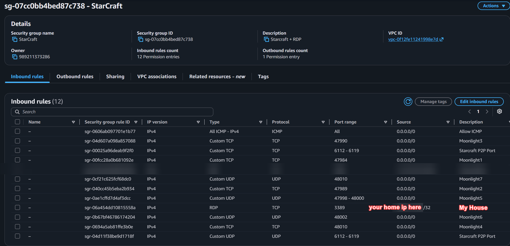
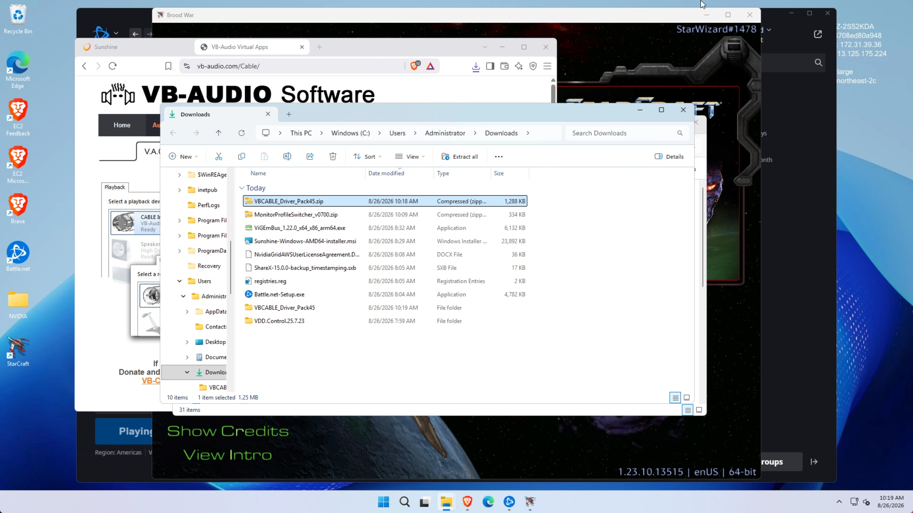
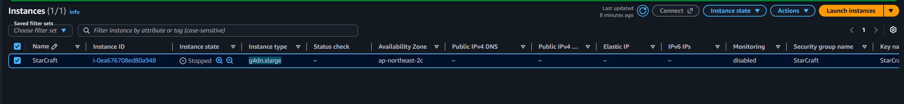

This is for advanced tech savvy people or people who are comfortable using AI to help them set this all up. Try at your own risk instructions might not be accurate use AI to help you.

This is the way I've been playing on the KR servers without having to pay for [GeForce Now](https://github.com/StarWhiz/starcraft-srd-3kingdoms-guide/tree/main/geforcenow-for-KR-servers). GeForce Now is much easier to set up though.

Anyways the point is this set up creates a KR computer in the Seoul Region. You will use a software combination called Moonlight and Sunshine to stream video from that machine to your machine. It will be like you're remote controlling the machine in KR.

Since Starcraft is P2P the Koreans won't experience lag from your KR virtual machine even on Turn Rate 24.

# Table of Contents
- [How much does it cost?](#how-much-does-it-cost)
- [Step 0. Create your AWS Account (use the advanced sign up)](#step-0-create-your-aws-account-use-the-advanced-sign-up)
- [Step 1. Request your GPU Quota Increase First](#step-1-request-your-gpu-quota-increase-first)
- [Step 2. Create the Security Group](#step-2-create-the-security-group)
- [Step 3. Create an IAM Role for the NVIDIA Driver Download](#step-3-create-an-iam-role-for-the-nvidia-driver-download)
- [Step 4. Launch the EC2 Instance](#step-4-launch-the-ec2-instance)
- [Step 5. First Connection with Remote Desktop](#step-5-first-connection-with-remote-desktop)
- [Step 6. Install Software on the EC2](#step-6-install-software-on-the-ec2)
- [Step 7. Connect from your Main Computer with Moonlight](#step-7-connect-from-your-main-computer-with-moonlight)
- [To Enhance performance further](#to-enhance-performance-further)
- [Day to Day Usage: Starting and Stopping](#day-to-day-usage-starting-and-stopping)
- [Troubleshooting](#troubleshooting)

# How much does it cost?
- As a new user you'll get some AWS credits so it will be some what free for about half a year or more ish.
- Storage costs about $4/mo at 50GB. This is the minimum amount you pay when the machine is off
- The actual machine when you turn it on, g4dn.xlarge, is charged per hour only while it's running. In Seoul with the Windows license it's roughly $0.80/hour. Check the [EC2 On-Demand pricing page](https://aws.amazon.com/ec2/pricing/on-demand/) with the region set to `Asia Pacific (Seoul)` and the OS set to `Windows` for the current price.
- Streaming video out of AWS counts as data transfer. The first 100GB per month is free, after that it's about $0.12/GB. Keeping the Moonlight bitrate around 10 Mbps (about 4.5GB per hour) is plenty for Starcraft and keeps this cheap.
- Unlike the easier [Nvidia Geforce Now method](https://github.com/StarWhiz/starcraft-srd-3kingdoms-guide/tree/main/geforcenow-for-KR-servers). The servers are actually in Seoul not Tokyo
- Another advantage is being able to host games.
- And you can port forward to host games

> [!TIP]
> Set up an AWS Budget alert so you get an email if you forget to turn the machine off. Search **Budgets** in the AWS Console > **Create budget** > **Use a template** > **Monthly cost budget** and enter something like `$20`.

# Step 0. Create your AWS Account (use the advanced sign up)
AWS has two different ways to sign up, and **this guide only works with the advanced one.**

- [Sign up for AWS (advanced)](https://docs.aws.amazon.com/accounts/latest/reference/getting-started.html) **<- Use this one.** You sign up as a **root user** with your own email address and get the normal AWS Console where you can pick any region, including Seoul.
- [Sign up for AWS (new)](https://docs.aws.amazon.com/accounts/latest/reference/sign-in-new.html) **<- Don't use this one.** It signs you in with Google, GitHub, Apple, or Amazon and puts everything in "projects". AWS picks the region for your project and you can't switch to Seoul, and the UI is completely different from this guide.

### How to sign up the advanced way
- Open this exact link: https://signin.aws.amazon.com/signup?request_type=register
    - Don't click **Sign in with Google / GitHub / Apple / Amazon**. That's the new sign up.
- Enter your email address (this becomes your **root user email**) and an AWS account name like `starcraft-kr`, then click **Verify email address**
- Enter the verification code from your email and click **Verify**
- Make a strong root user password and click **Continue**
- Choose your account plan. Pick **Paid plan** (see the note below)
- Enter your contact info and accept the AWS Customer Agreement
- Enter a credit/debit card. You can't finish sign up without one.
- Verify your phone number with the SMS code
- Choose the **Basic support (free)** plan
- Click **Complete sign up**
- Wait for the "your account is activated" email. It's usually a few minutes but can take up to 24 hours. Check your spam folder.
- Go to https://console.aws.amazon.com, choose **Root user**, and log in with your root user email and password

> [!IMPORTANT]
> **Pick the Paid plan, not the Free plan.** The Free plan only gives you access to some AWS services, and your account **closes by itself** after 6 months or when your credits run out, whichever comes first. You'd lose the whole machine. The Paid plan still gets the same $100 sign up credit (plus up to $100 more for doing AWS's starter activities). You only pay once those credits are used up.

> [!TIP]
> Turn on MFA (two factor login) for your root user since your credit card is attached. Click your account name in the top-right of the AWS Console > **Security credentials** > **Assign MFA device**.

# Step 1. Request your GPU Quota Increase First
Do this before anything else. Submitting it is free and takes about a minute, but AWS approval takes the longest of any step in this guide, so get it in the queue while you work on the rest.

A new AWS account has a **Running On-Demand G and VT instances** quota of **0**, and a `g4dn.xlarge` needs 4 vCPUs. Until this is raised your instance launch will just fail.

- Make sure you're in the **Seoul** region first. The region dropdown in the top-right of the AWS Console should read `Asia Pacific (Seoul) / ap-northeast-2`
- Search for **Service Quotas** in the top AWS search bar and open it
- Click **AWS services** in the left menu, search for **Amazon Elastic Compute Cloud (Amazon EC2)**, and click it
- In the search box under EC2 quotas, search for: `Running On-Demand G and VT instances`
- Click that quota, then click the orange **Request increase at account-level** button
- Change the quota value from `0` to `4` (or `8` if you want extra buffer)
- Click **Request**

You'll get an email when it's approved. You can do steps 2 and 3 while you wait.

# Step 2. Create the Security Group
The security group is the firewall that decides which ports on your EC2 can be reached from the internet. Create it first so you can pick it on the launch page.

- Make sure you're still in the **Seoul** region
- Search for **EC2** in the top AWS search bar and open it
- In the left menu click **Network & Security** > **Security Groups** > **Create security group**
- Security group name: `StarCraft`
- Description: `Starcraft + RDP`
- VPC: leave the default one
- Under **Inbound rules** click **Add rule** for each row below

| Type | Protocol | Port range | Source | Description |
|---|---|---|---|---|
| RDP | TCP | 3389 | My IP | Your Home |
| Custom TCP | TCP | 6112 - 6119 | Anywhere-IPv4 (0.0.0.0/0) | Starcraft P2P Port |
| Custom UDP | UDP | 6112 - 6119 | Anywhere-IPv4 (0.0.0.0/0) | Starcraft P2P Port |
| All ICMP - IPv4 | ICMP | All | Anywhere-IPv4 (0.0.0.0/0) | Allow ICMP |
| Custom TCP | TCP | 47984 | Anywhere-IPv4 (0.0.0.0/0) | Moonlight1 |
| Custom TCP | TCP | 47989 | Anywhere-IPv4 (0.0.0.0/0) | Moonlight2 |
| Custom TCP | TCP | 47990 | Anywhere-IPv4 (0.0.0.0/0) | Moonlight3 |
| Custom TCP | TCP | 48010 | Anywhere-IPv4 (0.0.0.0/0) | Moonlight4 |
| Custom UDP | UDP | 47998 - 48000 | Anywhere-IPv4 (0.0.0.0/0) | Moonlight5 |
| Custom UDP | UDP | 48002 | Anywhere-IPv4 (0.0.0.0/0) | Moonlight6 |
| Custom UDP | UDP | 48010 | Anywhere-IPv4 (0.0.0.0/0) | Moonlight7 |

- Leave **Outbound rules** as the default (all traffic allowed)
- Click **Create security group**

When you're done it should look like this:


> [!NOTE]
> - Choosing **My IP** for RDP fills in your home IP with `/32` at the end. Only your home can Remote Desktop into the machine. If your home IP ever changes, come back here and edit that rule.
> - Starcraft uses port 6112 by default. Blizzard recommends opening 6112 - 6119 so the game has fallback ports if 6112 is busy.
> - Port 47990 is the Sunshine web admin page. If you want to be extra safe, set its Source to **My IP** too. Once you're on Tailscale you don't need it open to the internet at all.

# Step 3. Create an IAM Role for the NVIDIA Driver Download
The NVIDIA GRID drivers for AWS are downloaded from an AWS S3 bucket, and the EC2 needs permission to read from it. The easiest way is to give the EC2 an IAM role.

- Search for **IAM** in the top AWS search bar and open it
- In the left menu click **Roles** > **Create role**
- Trusted entity type: **AWS service**
- Use case: **EC2**, then click **Next**
- In the permissions search box type `AmazonS3ReadOnlyAccess`, check the box next to it, then click **Next**
- Role name: `EC2-S3-ReadOnly`
- Click **Create role**

# Step 4. Launch the EC2 Instance
Once your quota increase from Step 1 is approved:

- Go back to **EC2** and double check the region is **Seoul**
- Click **Instances** in the left menu > orange **Launch instances** button
- **Name**: `StarCraft`
- **Application and OS Images**: click **Windows**, then pick **Microsoft Windows Server 2025 Base** (2022 Base also works. Don't use 2019, the current NVIDIA GRID drivers don't support it)
- **Instance type**: `g4dn.xlarge`
- **Key pair (login)**: click **Create new key pair**
    - Key pair name: `StarCraft`
    - Key pair type: **RSA**
    - Private key file format: **.pem**
    - Click **Create key pair**. Your browser downloads `StarCraft.pem`.
    - **Keep this file safe and don't lose it.** You need it to decrypt the Windows password in Step 5, and AWS can't give it to you again.
- **Network settings**: click **Select existing security group** and pick the `StarCraft` group you made in Step 2
- **Configure storage**: change it to `50` GiB, volume type `gp3`
- Expand **Advanced details** at the bottom. Under **IAM instance profile** pick `EC2-S3-ReadOnly` from Step 3
- Click **Launch instance**

> [!NOTE]
> The g4dn.xlarge also comes with a ~125GB "instance store" drive that shows up as a second disk in Windows. **Everything on that drive is wiped every time you stop the machine.** Install everything to the normal `C:` drive.

# Step 5. First Connection with Remote Desktop
Moonlight doesn't work until you've installed everything, so the very first time you connect you use Windows Remote Desktop (RDP). AWS doesn't let you choose the Windows password. It generates one and encrypts it with your key pair, so you need the `.pem` file from Step 4 to read it.

### Wait for the instance to be ready
- Go to **EC2** > **Instances**
- Wait until **Instance state** says `Running` and **Status check** says `3/3 checks passed` (or `2/2`). Click the refresh button every so often.
- Windows takes a few extra minutes to generate the password after it boots. If the next part says the password isn't available yet, wait about 5 minutes and try again.

### Get the Windows password
- Check the box next to your `StarCraft` instance and click **Connect** at the top
- Click the **RDP client** tab
- Username should be `Administrator`
- Click **Get password**
- Click **Upload private key file** and pick the `StarCraft.pem` file you downloaded in Step 4
- Click **Decrypt password**
- The password now shows on the page. Copy it and save it somewhere safe like a password manager.

### Connect with Remote Desktop
Still on that same **RDP client** tab:
- Click **Download remote desktop file**. You get a `.rdp` file.

**On Windows**
- Double click the `.rdp` file (or open **Remote Desktop Connection** from the start menu, click **Show Options** > **Open**, and pick the `.rdp` file)
- If it warns that the publisher is unknown, click **Connect**
- Paste the password from earlier and click **OK**
- If it warns that the identity of the remote computer can't be verified, click **Yes**
- You should now see the Windows Server desktop running in Korea!

**On Mac**
- Install **Windows App** (previously called Microsoft Remote Desktop) from the Mac App Store
- Double click the `.rdp` file, or drag it into Windows App
- Paste the password, then click **Continue** on the certificate warning

**On Linux**
- Use [Remmina](https://remmina.org/). Connect to the **Public DNS** shown on the RDP client tab with username `Administrator` and the password.

> [!TIP]
> Change the Administrator password to something you can remember. In the Remote Desktop session press `Ctrl + Alt + End` > **Change a password**. Don't use `Ctrl + Alt + Del`, that goes to your own computer.

> [!NOTE]
> The **Public IP** of the instance changes every time you stop and start it. When that happens just download a fresh `.rdp` file from the **Connect** page. Your password stays the same. After Tailscale is installed in Step 6 you won't really need this anymore.

# Step 6. Install Software on the EC2
Do everything in this section inside the Remote Desktop session. Microsoft Edge is already installed on the server for downloading things.

### Turn on Windows Audio
Windows Server has audio turned off by default. Right click the Start button > **Terminal (Admin)** or **Windows PowerShell (Admin)** and run:
```powershell
Set-Service -Name Audiosrv -StartupType Automatic
Start-Service -Name Audiosrv
```

### Install NVIDIA GRID Drivers
Official AWS instructions: https://docs.aws.amazon.com/AWSEC2/latest/UserGuide/nvidia-GRID-driver.html

- Open PowerShell (Admin) and paste this. It downloads the latest driver to a folder called `NVIDIA` on your desktop. (This is the part that needs the IAM role from Step 3.)
```powershell
$Bucket = "ec2-windows-nvidia-drivers"
$KeyPrefix = "latest"
$LocalPath = "$home\Desktop\NVIDIA"
$Objects = Get-S3Object -BucketName $Bucket -KeyPrefix $KeyPrefix -Region us-east-1
foreach ($Object in $Objects) {
$LocalFileName = $Object.Key
if ($LocalFileName -ne '' -and $Object.Size -ne 0) {
$LocalFilePath = Join-Path $LocalPath $LocalFileName
Copy-S3Object -BucketName $Bucket -Key $Object.Key -LocalFile $LocalFilePath -Region us-east-1
}
}
```
- Open the `NVIDIA` folder on the desktop, go into `latest`, and run the installer that matches your Windows Server version
- Click through with the default options and reboot when it asks
- Your Remote Desktop will disconnect. Wait a minute or two then reconnect with the same `.rdp` file and password.
- Open **Device Manager** > **Display adapters**. You should see **NVIDIA Tesla T4**.

### Install VB-Audio Virtual Cable
The EC2 has no sound card, so this gives it a fake speaker that Sunshine can capture sound from.
- Download it from https://vb-audio.com/Cable/
- Extract the zip, right click `VBCABLE_Setup_x64.exe` > **Run as administrator** > **Install Driver**
- Reboot and reconnect with Remote Desktop
- Right click the speaker icon in the taskbar > **Sound settings** and set the output device to **CABLE Input (VB-Audio Virtual Cable)**



### Install the Virtual Display Driver (VDD.Control)
The EC2 has no monitor plugged into its GPU. The Virtual Display Driver gives it a fake monitor running on the NVIDIA GPU, so Sunshine has a screen to stream.
- Download the latest **VDD.Control** / **Driver Installer (Windows 10/11)** zip from https://github.com/VirtualDrivers/Virtual-Display-Driver/releases
- Extract the zip to a folder and run the VDD Control app inside it
- Click **Install**
    - If it says `vcruntime140.dll not found`, install the latest **Microsoft Visual C++ Redistributable (x64)** and try again
- The default settings work. You don't need to pick a GPU because the **NVIDIA Tesla T4** is the only real GPU on the EC2, so leaving it on `default` uses it automatically.
    - For reference, here's the [vdd_settings.xml](vdd_settings.xml) from my working machine: 1 monitor, GPU on `default`, and resolutions from 800x600 up to 4K with 60 to 244Hz refresh rates. The driver's settings file is at `C:\VirtualDisplayDriver\vdd_settings.xml`. If you replace it with mine, restart the driver from VDD Control.
- Check **Device Manager** > **Display adapters**. You should see **Virtual Display Driver** next to the **NVIDIA Tesla T4**.

> [!NOTE]
> If you ever update the NVIDIA GRID driver, uninstall the VDD first and reinstall it afterward. The VDD project recommends this to avoid a black screen.

### Install Monitor Profile Switcher
This saves your display setup as a profile so Sunshine can switch the EC2 to the virtual display when you connect.
- Download `MonitorProfileSwitcher` from https://sourceforge.net/projects/monitorswitcher/ and extract it to a folder that won't move, like `C:\MonitorProfileSwitcher`
- That's it for now. You save the display profile later in [Step 7](#first-time-only-lock-in-the-virtual-display), because Remote Desktop shows its own fake display instead of the EC2's real ones.

### Install ViGEmBus
This lets Sunshine create a virtual game controller. Starcraft is keyboard and mouse so it's optional, but Sunshine will warn you about missing gamepad support without it.
- Download the latest `ViGEmBus_x.x.x_x64_x86_arm64.exe` from https://github.com/nefarius/ViGEmBus/releases
- Run it and click through with the default options

### Install Sunshine
Sunshine is the Moonlight server. It captures the EC2's screen with the NVIDIA GPU and streams it to Moonlight on your computer.
- Download the latest Windows installer (`Sunshine-Windows-AMD64-installer`) from https://github.com/LizardByte/Sunshine/releases/latest
- Run the installer with the default options
- When it's done, open `https://localhost:47990` in Edge on the EC2. Click past the certificate warning.
- Create a username and password for the Sunshine web page. Write it down, you need it to pair Moonlight in Step 7.
- Go to **Configuration** > **Audio/Video**
    - **Audio Sink**: `CABLE Input (VB-Audio Virtual Cable)`
    - **Adapter Name**: `NVIDIA Tesla T4`
    - **Output display**: pick the virtual display
- Click **Save**, then **Apply** (or restart Sunshine)

### Install Battle.net + Starcraft
- Download Battle.net from https://download.battle.net and install it
- Log in and install StarCraft: Remastered
- The first time you launch Starcraft, Windows Firewall will pop up. Click **Allow access** so other players can connect to you on ports 6112 - 6119.

### Install Tailscale
Tailscale makes a private network between your main computer and the EC2. It gives the EC2 an IP that never changes, and it improves delay a lot (USA to KR improved a lot for me).
- Sign up at https://tailscale.com (free for personal use)
- Download and install Tailscale for Windows on the EC2: https://tailscale.com/download/windows
- Log in to your Tailscale account
- Click the Tailscale icon in the taskbar and write down the EC2's Tailscale IP (starts with `100.`)

# Step 7. Connect from your Main Computer with Moonlight
Now everything happens on your main computer at home.

- Install Tailscale on your main computer and log in to the **same** Tailscale account
    - Connect to the tailscale network
- Install Moonlight on your main computer: https://moonlight-stream.org
- Open Moonlight. Click the **+** (Add Host) button and type in the EC2's Tailscale IP from Step 6
- Moonlight shows you a 4 digit PIN
- Go back to your Remote Desktop session on the EC2. In the Sunshine web page (`https://localhost:47990`) go to the **PIN** page, type in the 4 digit PIN, and give the device a name
- The EC2 now shows up in Moonlight as paired
- **Close your Remote Desktop session the right way before streaming.** See [Black screen or login screen in Moonlight](#black-screen-or-login-screen-in-moonlight) below. If you just close the Remote Desktop window, Windows locks the screen and Moonlight can't show it.
- Click the EC2 in Moonlight > **Desktop**. Remote into your EC2 with that tailscale IP! Congrats!

### First time only: lock in the virtual display
Do this once inside Moonlight (not Remote Desktop) so the EC2 always streams from the virtual display.
- Right click the desktop > **Display settings**
    - Click the virtual display, set it to `1920x1080`, and check **Make this my main display**
    - Under **Multiple displays** choose **Show only on** the virtual display
- Save this layout as a profile. Open PowerShell in the `C:\MonitorProfileSwitcher` folder and run:
```powershell
.\MonitorSwitcher.exe -save:C:\MonitorProfileSwitcher\stream.xml
```
- Open the Sunshine web page (`https://localhost:47990`) > **Configuration** > **General** > **Command Preparations** > **Add**
    - **Do command**: `C:\MonitorProfileSwitcher\MonitorSwitcher.exe -load:C:\MonitorProfileSwitcher\stream.xml`
    - Check **Run as administrator**
- Click **Save**, then **Apply**. Every time you connect, Sunshine now loads this display profile first.

### Recommended Moonlight settings
Starcraft doesn't need much, and lower bitrate keeps the data transfer cost down.
- Resolution: `1080p`
- Frame rate: `60 FPS`
- Video bitrate: about `10 Mbps`
- Video codec: `H.264` or `HEVC`

# To Enhance performance further
- Turn off Windows Network Throttling: 
    - Open Registry Editor on the VM (regedit), 
    - navigate to HKEY_LOCAL_MACHINE\SOFTWARE\Microsoft\Windows NT\CurrentVersion\Multimedia\SystemProfile
        - set NetworkThrottlingIndex to ffffffff (hexadecimal)
        - set SystemResponsiveness to 0. 
        - This prevents Windows from throttling network packet pacing during high-throughput video streaming.

# Day to Day Usage: Starting and Stopping
### To play
- Log in to the AWS Console, make sure the region is **Seoul**, and go to **EC2** > **Instances**
- Check your `StarCraft` instance > **Instance state** > **Start instance**
- Wait a minute or two for it to boot
- Make sure Tailscale is connected on your main computer, then open Moonlight and click the EC2

### When you're done (IMPORTANT)
- Go back to **EC2** > **Instances**
- Check your `StarCraft` instance > **Instance state** > **Stop instance**
- Wait until it says `Stopped`. You're only paying for storage now.



> [!WARNING]
> **Stop** the instance, never **Terminate** it. Terminate deletes the whole machine and everything you installed on it.
>
> Shutting down Windows from the Start menu inside Moonlight also works, it puts the instance in the `Stopped` state. Still double check the AWS console the first few times.

# Troubleshooting
### Instance launch fails with "You have requested more vCPU capacity than your current vCPU limit"
Your GPU quota from Step 1 hasn't been approved yet, or you requested it in a different region than Seoul.

### "Password is not available yet"
Windows is still setting itself up. Wait 5 to 10 minutes after the instance starts and try **Get password** again.

### Remote Desktop can't connect
- Make sure the instance is `Running` and passed its status checks
- Your home IP may have changed. Go to **EC2** > **Security Groups** > `StarCraft` > **Edit inbound rules**, and set the RDP rule's Source to **My IP** again
- The public IP changes on every start. Download a fresh `.rdp` file from the **Connect** page

### Black screen or login screen in Moonlight
When you close a Remote Desktop window, Windows locks the session, and Sunshine can't stream a locked screen. To fix it, disconnect Remote Desktop this way instead:
- On the EC2 desktop, create a text file called `disconnect.bat` (make sure it doesn't end in `.txt`)
- Put this in it:
```bat
for /f "skip=1 tokens=3" %%s in ('query user %USERNAME%') do (%windir%\System32\tscon.exe %%s /dest:console)
```
- Whenever you want to leave Remote Desktop and switch to Moonlight, right click `disconnect.bat` > **Run as administrator**. Remote Desktop closes and the desktop stays unlocked for Moonlight.

If you're already stuck, restart the instance from the AWS console. You'll see the Windows login screen in Moonlight and you can log in from there.

### No sound in Moonlight
- Make sure you ran the **Turn on Windows Audio** commands in Step 6
- Make sure the Windows output device is **CABLE Input (VB-Audio Virtual Cable)**

### Moonlight can't find the EC2
- Make sure Tailscale is connected on **both** machines and logged into the same account
- Make sure the instance is actually `Running` in the AWS console
